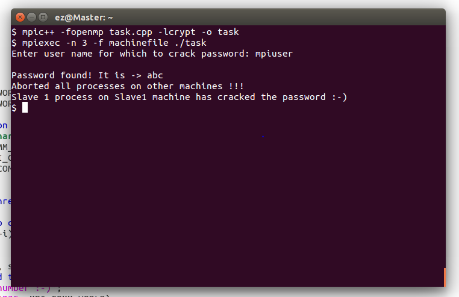
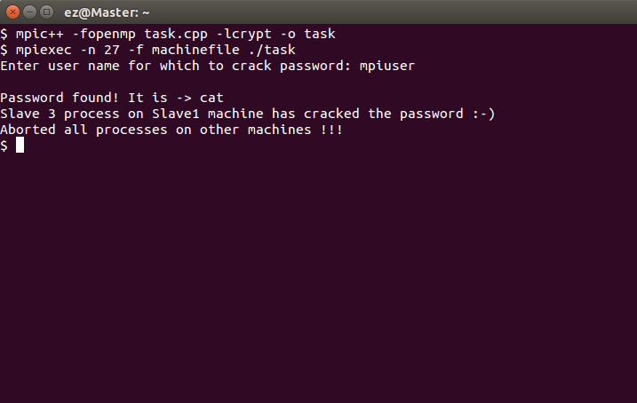
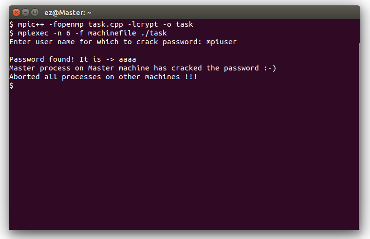

# Distributed Password Cracker with MPI and OpenMP

An educational C++ demonstration of hybrid parallel computing. The program divides a brute-force search across MPI processes and uses OpenMP threads within each process to coordinate searching and early termination.


## Technical highlights

- Partitions the lowercase candidate space among distributed MPI workers.
- Uses OpenMP to run the search and cancellation listener concurrently.
- Extracts SHA-512 `crypt` salts from shadow-format test records.
- Propagates a successful result to the coordinator and stops other workers early.
- Demonstrates MPI messaging, non-blocking receives, process discovery, and shared-memory threading.

See [Parallel architecture](docs/ARCHITECTURE.md) for the execution model and project limitations. The original assignment is retained in [Project Statement.pdf](Project%20Statement.pdf).

## Build

### Requirements

- Linux
- A C++17 compiler
- Open MPI
- OpenMP
- `libcrypt` development headers

On Ubuntu or Debian:

```bash
sudo apt-get install openmpi-bin libopenmpi-dev libcrypt-dev
make
```

The executable is created at `build/password-cracker`.

## Run in a controlled lab

Create a `shadow.txt` containing only an account/hash record you own and are authorized to test. Do not commit that file; it is ignored by Git.

For a local multi-process demonstration:

```bash
mpiexec -n 5 ./build/password-cracker
```

For multiple hosts, provide an Open MPI hostfile according to your cluster configuration.

## Screenshots

| Distributed execution | Password discovery |
| --- | --- |
|  |  |



## Responsible use

This repository is a university parallel-computing project. Use it only with hashes and systems you own or have explicit permission to assess. It is not designed for unauthorized access or production password recovery.

## Contributors

- [Sameet Asadullah](https://github.com/SameetAsadullah)
- [Tayyab Ali](https://github.com/DarkDragz)
- [Tayyab Abbas](https://github.com/tayyababbas2000)
- [Aysha Noor](https://github.com/ayshanoorr)

## License

Licensed under the [MIT License](LICENSE).
